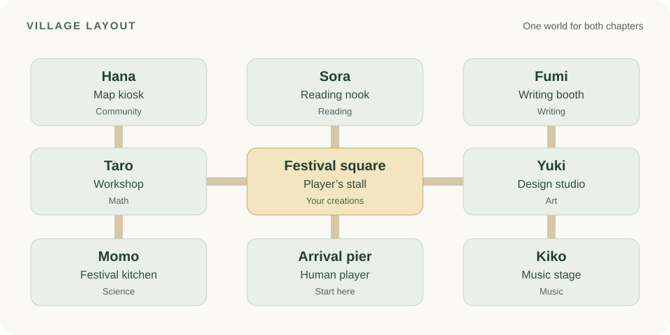

# All Aboard

**A learning adventure in an animal village**

We’re building a 2D pixel-art game for neurodivergent children, set in a village preparing for a Japanese summer festival. A human player meets animal neighbors, chooses which subjects to explore, and adds their creations to a festival stall.

## Start here

### [Read the Character and Art Plan](docs/All_Aboard_Character_and_Art_Plan.md)

The plan covers the **10-character cast**, village layout, front-end screens, sprite sizes, and the first batch of artwork to create.

## Our first chapters

| Chapter | Audience |
| :--- | :--- |
| **Chapter 0** | Kindergarten |
| **Chapter 1** | Grades 1–5 |

Both chapters share the same village and cast. Players can choose among **math, science, reading, writing, art, social studies and community, and music** in any order, switch subjects, and return to unfinished activities.

## The village

See the [full art guide](docs/All_Aboard_Character_and_Art_Plan.md#asset-guide) for export sizes and the [first art batch](docs/All_Aboard_Character_and_Art_Plan.md#first-art-batch) for the initial checklist.
