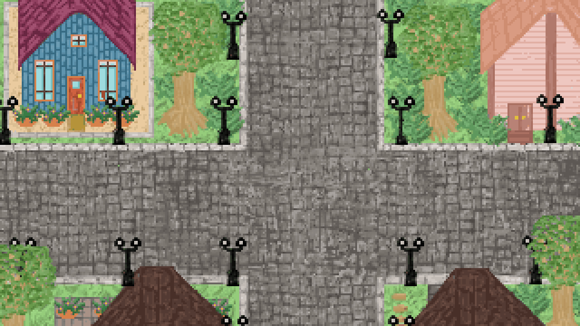

# All Aboard · Summer Festival

**A learning adventure in an animal village**

All Aboard is a playable village adventure for **Kindergarten and grades 1–5**, designed with neurodivergent children in mind. Explore Willow Bay as it gets ready for a Japanese summer festival, meet animal neighbors in handheld-game encounter scenes, and put your own creations into the village and its parade.

## Quick start — play on your computer

### 1. Install Node.js

Install the **LTS version** from [nodejs.org](https://nodejs.org/en/download), then reopen Terminal. The project requires Node.js 20 or newer; npm comes with the Node.js installer.

### 2. Get the project and start it

Open Terminal and paste:

```sh
git clone https://github.com/dongt10/all-abroad.git
cd all-abroad
npm run dev
```

**Already have the project?** Open Terminal in its folder and run `npm run dev`.

**Don’t use Git?** Select **Code → Download ZIP** on this page, unzip it, open the extracted folder in Terminal, and run `npm run dev`.

There are no packages to install, API keys to add, or accounts to create.

### 3. Open the game

Open **[http://127.0.0.1:4173](http://127.0.0.1:4173)** in your browser. Keep Terminal running while you play; press **Control + C** in Terminal to stop the server. This address works on the computer running the game.

<details>
<summary><strong>Having trouble starting?</strong></summary>

- **“node” or “npm” command not found:** install Node.js using the link above and reopen Terminal. Run `node --version` and `npm --version` to check the installation.
- **“git” command not found:** use **Code → Download ZIP** instead.
- **Can’t find `package.json`:** run the command from the extracted or cloned project folder, where `package.json` is located.
- **Port 4173 is already in use:** the demo may already be running. Try opening the game link above. To use another port on macOS or Linux, run `PORT=4174 npm run dev`, then open `http://127.0.0.1:4174`.

</details>

## How to play

- **Pick who you are** (boy or girl) and your grade: **Kindergarten** or **1–5**. Then press **▶ Start**.
- **Pip says hello at the crossroads:** “Welcome to Willow Bay! Tap a neighbor to help them make something.” He says it on every visit until you make your first thing in that grade.
- **Walk around Willow Bay’s cobblestone crossroads.** Everyone stays on the road; the seven neighbors stroll beside their stalls along the road. Tap one, or walk up and press Enter, to start their activity. A stall marked **!** has something new to make; **...** means you started it and can continue. Pip and Nori wander along the road and say hello.
- **Open the Guide** (top right) to meet the whole cast. It is the Matsuri Guide, “the town’s character book.” Each neighbor’s page says what you’ll learn, and shows the stamp once you make their thing. Choose **Find** for an arrow that leads you to them, or **Visit** to go straight to their activity. The header counts your stamps, “0 of 7 stamps.”
- **Help each neighbor make something.** Kindergarten and grade 1 balance Taro’s cart, shade Momo’s ice, pack Sora’s story bag, and plan Hana’s square. Grade 2 builds Taro’s crate rows, compares cups in Momo’s bean test, follows Hana’s compass errands, and puts Sora’s story ribbon in order. Grades 3–5 share pizza, build a food-chain chart, name tales with evidence, and match helpers to jobs. Every grade also stamps Yuki’s banner, writes Fumi’s sign, and makes a band with Kiko, with goals that grow by grade. The table below explains each task.
- **Finish your creation.** Each encounter shows at most four commands. The green finish command is last and stays gray until the work is ready: **Send cart**, **Serve ice**, **Share story**, **Open square**, **Plant bed**, **Hang map**, **Share ribbon**, **Serve pizza**, **Pin chart**, **Share tales**, **Start day**, **Hang banner**, **Put up sign**, or **Send band**. In the story bag, **Share story** appears after all three things are packed. Help names the steps and the finish. A wrong try explains why and keeps your work. Finishing shows what you made, then puts it at that neighbor’s stall.
- **Festival board** (bottom left) reads “Festival board · 0 of 7” and fills in as you make things. After your first creation, the **Parade** button appears beside it.
- **Parade.** Everyone who helped marches with what you made. **Play band** plays your band if you made one with Kiko. After two laps (right away with Calm motion) the line stops and the dialogue says “The parade is over. Make more, and march again!” **March again** restarts it.
- **The finale at seven.** With all seven made, the board says “7 of 7 · Festival complete!” and the parade ends with “Everyone marched! You made the whole festival.”
- **Back to the start:** **Pause** (top right) has **Keep playing** and **Title screen**. Who you are and your grade live on the title screen.

Everything saves in this browser, separately for Kindergarten and each grade.

### Controls

| Action | Keyboard | Touch or mouse |
| :--- | :--- | :--- |
| Move | Arrow keys or WASD along the road | Tap the road to walk there, or a neighbor to walk over |
| Choose (A) | Enter, Space, or Z | Tap a command |
| Back (B) | Esc, X, or Backspace | ← Village, or a window’s close button |
| Next page | Enter, Space, or Z (the A action) | Tap the dialogue |

Every dialogue box has a **Hear** tab that reads the current line and a **Help** tab with numbered steps for that screen. In Fumi’s text field, Esc moves focus to the commands; press it again to return to the village. Other keys stay in the field.

Tap a house or grass and you stop at the road’s edge. With nobody nearby, Enter shows a walking hint that closes after three seconds and moves above the player when needed. Read to me finishes the spoken hint before the closing delay.

### Comfort settings

On the title screen and in **Comfort** (top right in the village):

- **Bigger words** makes every word larger.
- **Calm motion** stops walking, bobbing, marching and screen wipes. It also follows your device’s reduce-motion setting.
- **Read to me** reads each new line aloud. **Hear** reads the current line any time.

> **Prototype scope:** seven creative encounters with grade-aware prompts and controls, an explorable village, a parade, and local saving. This is an interaction prototype, not a full curriculum. It has no accounts or remote backend, and every line a child reads was written by hand. Read aloud uses available browser voices; music uses browser audio and can remain silent.

### Kiko’s music stage, by grade

Choose Kiko to open the Sound Garden. A fresh band starts with the **Minecraft preset**, a short, editable piano-style example based on C418’s “Minecraft.” It repeats through the same band engine as the child’s own music: change the lantern notes, invite or rest friends, adjust their volumes, and try different speeds. Grades 1–2 and 4–5 start with Cricket’s rhythm enabled for their rhythm and steady-part lessons; Kindergarten and grade 3 can invite Cricket. Existing saved tunes keep their notes and sounds.

The **preset button** at the top right offers **Minecraft** and the original **Meadow Band** as starting tunes. A preset choice keeps the current Band volume and Form; **Undo preset** restores the previous score if the child changes their mind. A new stage starts playing when sound is allowed. **Stop** and **See beat** remember the preference for silent entry; **Play band** enables playback again. Read to me and saved zero volume keep entry silent. If the browser blocks playback, press Play band.

The four learning commands are **Play band** (then **Stop**), **See beat** (silent lantern lights, then **Stop**), **Sounds**, and **Send band**. **Send band** stays gray until the grade’s lesson is done: Kindergarten explicitly starts Play band or See beat, or makes an edit; grade 1 changes Cricket’s sound/rest rhythm; grade 2 matches an Echo rhythm; grades 3–5 change Kiko’s melody from the selected preset. At grades 1–5, volume, Speed, Form and other friends’ edits do not complete the lesson. Automatic playback and a preset switch alone do not count. Saved lesson edits count on return, and an already published band stays ready.

Tap a friend to invite or rest them. The **Speed** sign in the top row cycles **Slow · Steady · Fast** at every grade. What the eight lanterns do depends on the grade:

| Grade | What the child does on the stage | Kiko’s opening line |
| :--- | :--- | :--- |
| Kindergarten | The lanterns light up as the band plays. Tap Speed for Slow, Steady, or Fast. Each friend’s line names its low, middle, or high part. The Sounds window has Loud and Soft buttons for each friend. | Tap a friend to rest or join. Who plays low? Who plays high? Try Slow and Fast! |
| Grade 1 | Cricket’s rhythm is on the lanterns. Tap a lantern to switch it between a sound and a rest. Kiko counts: “Five sounds and three rests. Nice spacing!” | Tap a lantern: sound or rest. Rests are part of the rhythm too! |
| Grade 2 | Same lanterns, plus an **Echo** sign. Kiko plays an 8-beat rhythm and flashes it on the lanterns, the lanterns clear, and you copy it. When it matches, Kiko asks for one back. | Press Echo. I play a rhythm, then you copy it on the lanterns! |
| Grade 3 | Kiko’s tune is on the lanterns. Each tap climbs Rest → Do → Re → Mi → Sol → La → Rest, and each lantern hangs at the height of its note, so the string becomes a staircase. Kiko says whether the tune goes up, down, stays the same, or goes up and down. | Tap a lantern to climb: Do, Re, Mi, Sol, La. Does your tune go up or down? |
| Grade 4 | The same staircase. Cricket wears a “steady part” badge and keeps the same rhythm while the tune changes. The band plays two phrases, A B: your tune, then each friend’s other tune. The Form sign shows A B and is locked. | Cricket repeats the steady part. Change my tune above it! |
| Grade 5 | The same staircase, plus the **Form** sign: tap it for A → A B → A B A. The band starts on A B A, so the first part comes back at the end. | Make tune A, then tap Form for A B A. Which part comes back? |

**Help** on the stage has four steps per grade, and the last one always names Send band.

Older grade-4 saves that load as A now open as A B, with the same notes and mix settings; Form stays locked.

**Sounds window:** one tab per friend. Each tab has that friend’s volume. Friends not edited on the lanterns also have **Tune 1 / Tune 2**, with a small preview of the beats. Kindergarten gets **Loud / Soft** buttons instead of a slider and no beat grid. From grade 1, a friend who is not on the lanterns gets a beat editor in the window: sound or rest at grades 1–2 (and always for Cricket), the note staircase for Sora and Nori at grades 3–5. The friend who is on the lanterns (Cricket at 1–2, Kiko at 3–5) gets “Edit Cricket’s rhythm on the lanterns.” or “Edit Kiko’s tune on the lanterns.” instead of tune buttons or a beat editor. A **Band volume** slider controls the whole band at every grade.

**Recording:** open the **Guide**, choose **Kiko**, and once a band has been sent, **Save song** downloads `my-festival-band.wav`: two runs of A, one run of A B, or one run of A B A, following the saved form. The saved preset’s sounds and the child’s edits are included.

**Musical reference:** [“Minecraft” by C418 (Daniel Rosenfeld), from Minecraft – Volume Alpha](https://c418.bandcamp.com/track/minecraft). The preset is a simplified eight-step teaching arrangement of its opening motif, using the reference’s G-flat pentatonic pitch set, a slower starting tempo, and synthesized piano tones. It is editable score data; no C418 recording is bundled. Its accompaniment and optional rhythm are adapted for the four friends and grade activities. The child’s exported WAV and parade play their saved arrangement, including edits and the selected preset’s sounds.

### What changes by grade

Kindergarten and grade 1 keep the cart, ice, packing story and square. Grade 2 has four activities of its own; grades 3–5 use pizza, food chains, tales and Help Day with the differences below. The Guide’s “You’ll learn” text follows the grade; finishing earns that neighbor’s stamp. Older untagged cart, ice, story-bag and square creations keep their original pictures and learned statements.

| Subject | K | 1 | 2 | 3 | 4 | 5 |
| :--- | :--- | :--- | :--- | :--- | :--- | :--- |
| Math | **Taro’s cart:** match two single crates, then **Roll it!** and **Send cart**. | **Taro’s cart:** use crates of 1 and 2 to match a weight of 3, then roll and send. | **Taro’s crate rows:** build equal, gap-free rows for 12, 10, 8 or 6 crates. **Pair up** shows odd or even; **Send cart** when the rows match the order. | **Taro’s pizza party:** start with 8 slices. Hand out every slice equally to four friends, choose **Dig in!**, then **Serve pizza**. | **Taro’s pizza party:** start with 12 slices. Share every slice equally, check, then **Serve pizza**. | **Taro’s pizza party:** use 6 or 10 slices. Cut into halves, share every piece equally, check, then **Serve pizza**. |
| Science | **Momo’s ice test:** shade one tray, **Wait 5 min** twice, compare the ice words, then **Serve ice**. | **Momo’s ice test:** shade, wait and compare the two trays, then **Serve ice**. | **Momo’s bean test:** choose **No water** or **Dark box** for cup B. Wait two weeks; add Seed, Sun, Water and Bee to the bed card, then **Plant bed**. | **Momo’s sunbeam chart:** Sea plant → Little fish → Otter or Gull. Place 1000 → 100 → 10, choose **Shine!**, then **Pin chart**. | **Momo’s sunbeam chart:** Pondweed → Snail → Koi or Frog. Place 2000 → 200 → 20, shine, then **Pin chart**. | **Momo’s sunbeam chart:** the bay chain uses 5000 → 500 → 50 and “10%.” Place every number, shine, then **Pin chart**. |
| Reading | **Pack for the festival:** match Key, Umbrella and Book to pictures, then **Next part** and **Share story**. | **Pack for the festival:** read short lines that name the three things to pack, then **Share story**. | **Sora’s story ribbon:** read five lines, answer why, tap beginning/middle/end in order, and choose the lesson. **Share ribbon** saves it; **Next story** switches Taro’s sandal and Kiko’s drum. | **Whose tale is this?** Name three neighbors and choose each proof line, then **Share tales**. Starts with Momo, Taro and Kiko. | **Whose tale is this?** Same proof task; starts with Hana, Pip and Yuki. **Share tales** finishes three. | **Whose tale is this?** Same proof task; starts with Fumi, Nori and Sora. **Share tales** finishes three. |
| Writing | **A sign from you:** tap at least two word tiles, then **Put up sign**. No typing box. | **A sign from you:** make a complete sentence with a capital first and . or ! last, then **Put up sign**. | **A sign from you:** the same sentence goal with eight tiles or typing, then **Put up sign**. | **A sign from you:** make two complete sentences with a describing word. Four phrase tiles, six describing tiles, or typing; **Put up sign**. | **A sign from you:** two complete sentences with a describing word, then **Put up sign**. | **A sign from you:** two complete sentences with a describing word, then **Put up sign**. |
| Art | **Yuki’s banner:** add any stamp; **Turn**, **Fill cloth** and **Undo** help you design it. **Hang banner** finishes. | **Yuki’s banner:** continue the star/circle pattern across the top row, then **Hang banner**. | **Yuki’s banner:** continue the coral/blue flower pattern across the top row, then **Hang banner**. | **Yuki’s banner:** make matching left/right mirrors with at least four stamps, then **Hang banner**. | **Yuki’s banner:** make matching mirrors with at least six stamps in two colors, then **Hang banner**. | **Yuki’s banner:** make matching mirrors with at least six stamps in two colors, then **Hang banner**. |
| Community | **Room for every neighbor:** put a bench off the path, choose **Try it**, then **Open square**. | **Room for every neighbor:** add a bench and a garden by the quiet trees, keep the path clear, try, then **Open square**. | **Hana’s compass errands:** tap three map destinations: north 1, west 2, then east 2 and south 1. **Hang map** finishes all three. | **Hana’s Help Day:** match Kiko, Taro, Nori and Pip to four jobs with strength labels shown, then **Start day**. | **Hana’s Help Day, set B:** Momo cooks stew, Sora tells a tale, Yuki paints the banner and Fumi writes signs. Match all four to **Start day**. | **Hana’s Help Day:** the grade-3 team returns with strength labels hidden. Ask or infer each fit, then **Start day**. |
| Music | **Kiko’s Sound Garden:** start **Play band** or **See beat**, or make an edit, then **Send band**. Explore fast/slow, high/low and loud/soft. | Change Cricket’s sound/rest rhythm, then **Send band**. | Match an eight-beat **Echo**, then **Send band**. | Change Kiko’s Do/Re/Mi/Sol/La tune from the preset, then **Send band**. | Change Kiko’s tune above Cricket’s steady part in A B, then **Send band**. | Change tune A, explore Form A B A, then **Send band**. |

Taro’s starting crates stay tied to the cart. Load the right side to match, and tap a crate you added to take it off. Grade-5 pizza requires a cut before serving; older saved pizzas still load.

In Momo’s charts, the Sun supplies sunlight without a number. The plant has the largest number; each feeding arrow divides by 10. In the bean test, **Wait a week** advances the test, **Next step** gives a hint, and **Start over** clears the cups and bed.

Hana’s compass map connects each delivery to a neighbor’s job. **Next errand** repeats the current clue, **Compass** explains directions, and **Start over** clears the routes. Help Day uses **Ask** and **Next job** for clues.

At grades 3–5, tap a named tale or a filled book slot to reread all three lines with the proof highlighted. **All tales** returns to the finished book; **Next tale** returns to the first unnamed story. **Start over** cycles tale decks. In the grade-2 ribbon, **Read again** rereads the five-line story and **Start over** resets its tasks.

Children can tap every sign; grades 1–5 can also type. **Remove word** takes back a whole tile in grades 3–5. The [roadmap](ROADMAP.md) lists the deeper goals still planned.

<details>
<summary><strong>Build, checks, and where to make changes</strong></summary>

```sh
npm test
npm run build
```

The build produces a static site in `dist/`, ready for a static web server. Serve the game over HTTP rather than opening `index.html` directly. The **[style guide](styleguide.html)** (`/styleguide.html` while the dev server runs) shows the palette, type, pixel windows, icons, the cast, and live controls.

| File | Purpose |
| :--- | :--- |
| `src/main.js` | Starts the game and connects the screens |
| `src/ui/stage.js`, `src/ui/tokens.css`, `src/ui/kit.css`, `src/ui/palette.js` | The 960×540 stage, colors, fonts, and pixel windows |
| `src/ui/figures/` and `assets/figures/` | Character sprite sheets and how they are drawn |
| `src/ui/input.js`, `src/ui/menu.js`, `src/ui/dialogue.js`, `src/ui/window.js`, `src/ui/scenes.js`, `src/ui/voice.js` | Keys, the command menu, dialogue, windows, scene changes, and read aloud |
| `src/ui/screens/` | Title, village, encounter, music, sounds (the Sounds window), parade, and windows (Comfort, Pause, Guide, Help) |
| `src/ui/activities/` | Cart, ice, story, square, banner and sign screens |
| `src/ui/activities/pizza.js`, `src/ui/activities/chain.js`, `src/ui/activities/helpday.js`, `src/ui/activities/tales.js` | The four grade 3–5 activity screens |
| `src/ui/activities/rows.js`, `src/ui/activities/beans.js`, `src/ui/activities/compass.js`, `src/ui/activities/ribbon.js` and their `.css` files | Grade-2 crate rows, bean cups, compass map and story ribbon fields and commands |
| `src/ui/screens/sounds.js` | The music stage’s Sounds window |
| `src/ui/registry.js` | Which activity each neighbor opens, checking exact grade before the grade band |
| `src/ui/band.js` | Music rules by grade: lead musician, speed, form, melody shape, echo, Kiko’s lines |
| `src/ui/village-map.js`, `src/ui/parade-lineup.js` | Stall states, the festival board label, who marches and when the parade ends |
| `src/ui/guide.js` | The Matsuri Guide’s entries and stamps |
| `src/data.js`, `src/encounters.js`, `src/reading.js` | Neighbors, activity rules by grade band, and the packing story |
| `src/pizza.js`, `src/chain.js`, `src/helpday.js`, `src/tales.js` | Rules, dialogue, saved creations and completion checks for the grade 3–5 activities |
| `src/rows.js`, `src/beans.js`, `src/compass.js`, `src/ribbon.js` | Grade-2 rules, dialogue, saved creations and completion checks |
| `src/banner-rules.js`, `src/sign-rules.js` | Banner pattern/mirror goals and sign sentence/describing-word goals |
| `src/progress.js` | Saving, drafts, creations, and grade scopes |
| `src/music.js` and `src/audio.js` | Band playback, tempo and form, and WAV export |
| `tests/` | Logic, save, art, and interface checks |

</details>

### [Read the Character and Art Plan](docs/All_Aboard_Character_and_Art_Plan.md)

The plan covers the cast, village layout, front-end screens, sprite sizes, and the first batch of artwork to create.

All seven neighbors plus Pip and Nori are now drawn from the team’s reference drawings in [docs/art/source/neighbors/](docs/art/source/neighbors/). Their sheets are derived using [manifest.json](docs/art/source/neighbors/manifest.json), never redrawn or recolored. The references are pinned by hash and never replaced; [tests/figures-references.test.js](tests/figures-references.test.js) checks the drawings and derived pixels. To change the art, change the reference and the pinned hash on purpose.

## Our first chapters

| Chapter | Audience |
| :--- | :--- |
| **Chapter 0** | Kindergarten |
| **Chapter 1** | Grades 1–5 |

Both chapters share the same village and cast. Players can choose among **math, science, reading, writing, art, social studies and community, and music** in any order, switch subjects, and return to unfinished activities.

## The village

Willow Bay is the team’s hand-drawn cobblestone crossroads. The road is the only walkable ground; the stalls stand along its edges.



See the [full art guide](docs/All_Aboard_Character_and_Art_Plan.md#asset-guide) for export sizes and the [first art batch](docs/All_Aboard_Character_and_Art_Plan.md#first-art-batch) for the initial checklist.
